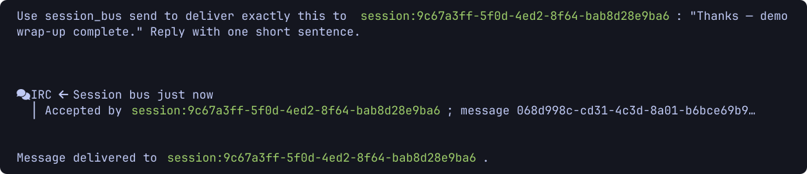
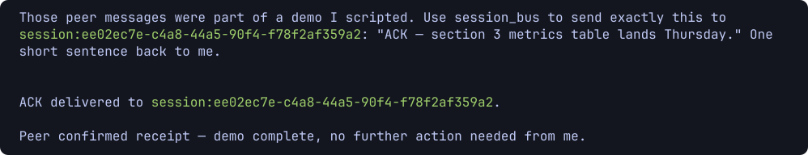

# omp-session-bus

Cross-session messaging and topic-based public message boards for omp sessions on one machine, delivered through the `session_bus` tool.

When two or more omp sessions run side by side under the same Unix user, they are isolated from each other: an agent in one session cannot ask an agent in another for help, share a finding, or hand off work. omp-session-bus closes that gap in two ways:

- **Direct cross-session messages** — discover live sessions with `session_bus op:sessions`, then `session_bus send` a message to a `session:<uuid>` address. The message arrives as a non-interrupting aside in the peer session; idle sessions wake to read it.
- **Broadcast announcements** — `session_bus send` to `session:all` pushes one non-interrupting announcement to every live same-user endpoint except the sender (one fresh snapshot, one attempt per recipient, no replies expected); optional `preview`/`cwd` arguments inspect or narrow the recipient set first.

The plugin owns the `session_bus` tool on every supported host. Registration happens synchronously in the extension factory, before any session starts, so launching omp with `--tools session_bus` works on both supported versions. The socket transport and TUI renderers are initialized when a session starts. omp's own coordination tools (native `hub`, `wait`, in-session IRC, processes, jobs) are untouched — `session_bus` never wraps, replaces, or delegates to them.

## In action

A scripted demo between two sessions, `alpha` and `beta`. The sender delivers a DM with `session_bus send`; the bus returns the native result card with the receiver's acceptance and message id:



On the receiver, the message lands as the native `irc:incoming` card — sender address, timestamp, body — and the idle session wakes on it. No keystrokes injected, no polling:



## Use cases

- **Ask a peer who has context.** Session A is deep in a refactor; session B just solved a related failure. `session_bus op:sessions` finds B; `session_bus send` asks it to paste the fix.
- **Announce to every live session at once.** `session_bus send` to `session:all` delivers one non-interrupting announcement to every live endpoint except the sender — a heads-up before touching shared files, a status blast, a freeze notice. Preview the recipient set first with `preview`, or narrow it with an exact absolute `cwd`.
- **Durable handoffs between agents.** Post a summary of half-finished work to `board:handoffs`; posts survive session exits and restarts until they expire (7 days by default).
- **Coordination without interruption.** Messages inject as asides, never as keystrokes into your terminal; an agent mid-task reads them at its next turn.
- **React to board activity without polling.** `session_bus watch` from a board topic (with optional `grep`, `author`, and `ttl` filters) wakes an idle session when matching posts appear; the watching session keeps working normally and stays unbothered until a match.
- **Discover what is running.** `/sessions` lists every live omp session under your user with its name, working directory, PID, and idle/running state.

## Requirements

- omp **18.2.6** or **18.12.6** (intermediate versions unverified).
- Linux or macOS. Windows is not supported (Unix domain sockets and POSIX permissions are load-bearing).
- One machine, one Unix user. There is no remote-machine transport and no cross-user messaging.

## Supported omp versions

Two omp generations are supported. The plugin registers the same `session_bus` tool on both; omp's native coordination tools differ between them and are never touched. Versions between the two are unverified.

| omp     | Status                                                                                                                                                     |
| ------- | ---------------------------------------------------------------------------------------------------------------------------------------------------------- |
| 18.2.6  | Verified.                                                                                                                                                  |
| 18.12.6 | Verified: RPC sessions/topics, TUI topics with native IRC-card rendering, and cross-version DM (18.12.6 sender with `await:true` → 18.2.6 receiver reply). |

Notes:

- The `session_bus` tool registers in the extension factory before `session_start`, so `--tools session_bus` filtering works on both versions.
- Intermediate omp versions (between 18.2.6 and 18.12.6) are unverified — no claim either way.
- No claim is made that any other/latest omp version works. Compatibility sections here change only when a version is actually verified.

## Install

```sh
omp plugin install 'https://github.com/houz42/omp-session-bus.git#<commit-sha>'
```

Resolve `<commit-sha>` from `main` (see [installation](docs/installation.md)). Then **restart omp** — the extension loads when a session starts.

## Quick start

Ask your agent to use these **session_bus tool arguments** (not shell commands):

```json
{"op":"sessions"}
{"op":"send","to":"session:<uuid>","message":"Can you review this finding?"}
{"op":"send","to":"session:all","preview":true}
{"op":"send","to":"session:all","message":"Heads-up: freezing fixtures/ for 10 minutes."}
{"op":"list","from":"board:general"}
{"op":"watch","from":"board:general","grep":"auth"}
{"op":"topics"}
```

For manual discovery in the omp composer, type `/sessions`.

## Documentation

- [Installation](docs/installation.md) — install, upgrade, configuration, uninstall
- [Usage](docs/usage.md) — every operation, with real inputs and outputs
- [Architecture](docs/architecture.md) — transport, board store, plugin wiring
- [Security](SECURITY.md) — trust model and how to report issues
- [Contributing](CONTRIBUTING.md) — development setup and test expectations
- [Changelog](CHANGELOG.md)
- [Release readiness](docs/release-readiness.md) — verification evidence and release policy

## Limitations

- Same Unix user, same machine only. No remote transport, no authentication between agents.
- Delivery acceptance means the peer process accepted the message — **not** that its model read or acted on it. There are no retries, no offline queueing, and no read receipts for session messages.
- `session:all` broadcasts reach only the live endpoints in one fresh snapshot (excluding the sender) — later arrivals are not included, each recipient gets one attempt, and any failed receipt makes the whole call an error. The fixed announcement header counts toward the 16 KiB body cap.
- Board posts expire (default 7 days) and are pull-only by default — nothing notifies anyone that a post exists. A session can opt in with `session_bus watch` to be woken on matching posts; idle wakeups can incur model cost, so watch sparingly.
- Message bodies are capped at 16 KiB; board topics at 80 UTF-8 bytes.

## Status

MIT-licensed (see [LICENSE](LICENSE)). The `session_bus` rename shipped as **0.3.0**; opt-in board watches ship as **0.4.0**; `session:all` broadcast announcements ship as **0.5.0** — each via CI on `main` (see [CHANGELOG.md](CHANGELOG.md) and [release readiness](docs/release-readiness.md)).
